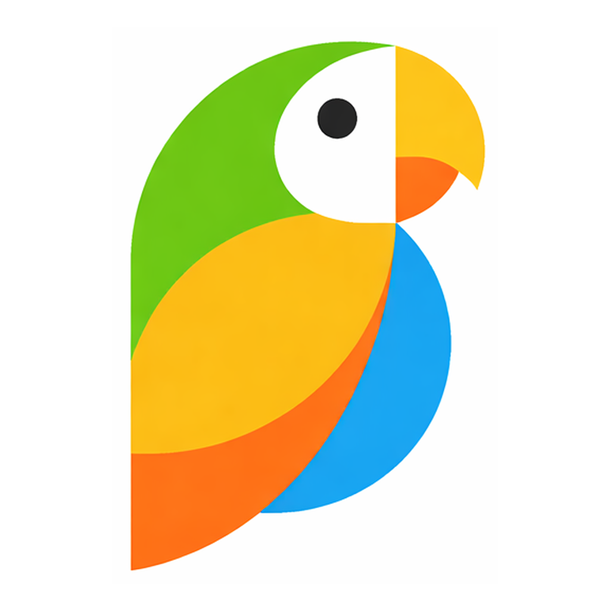
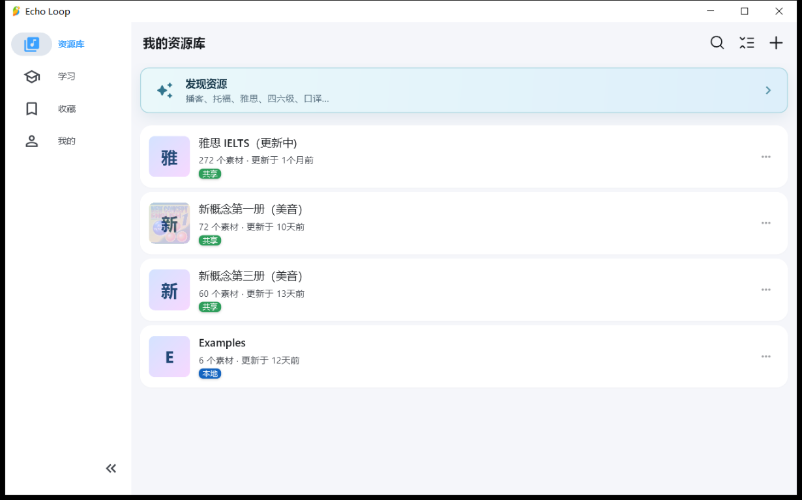
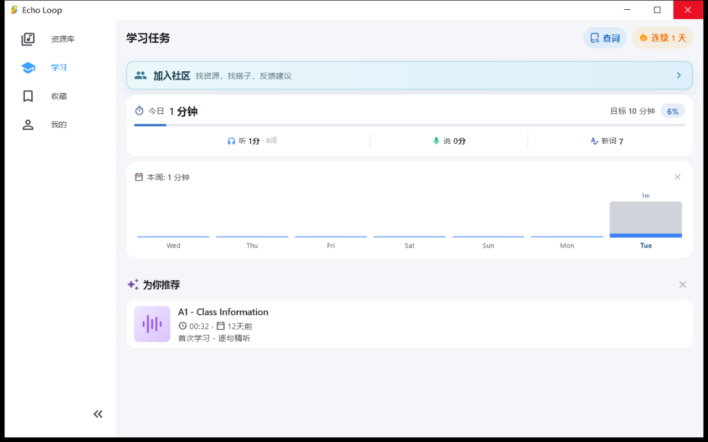
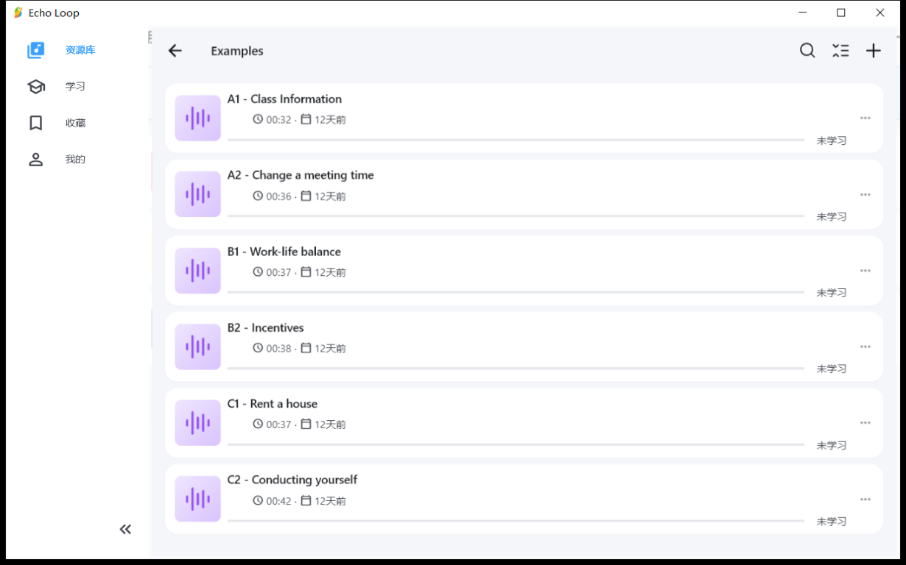
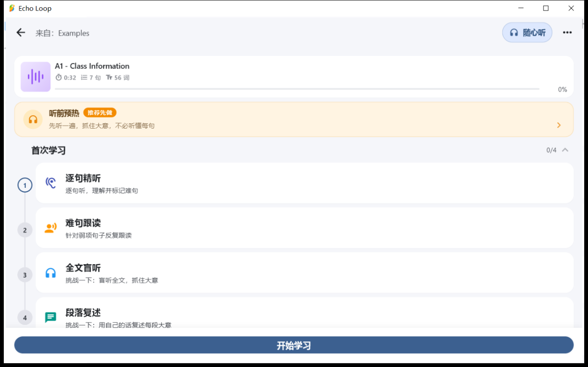
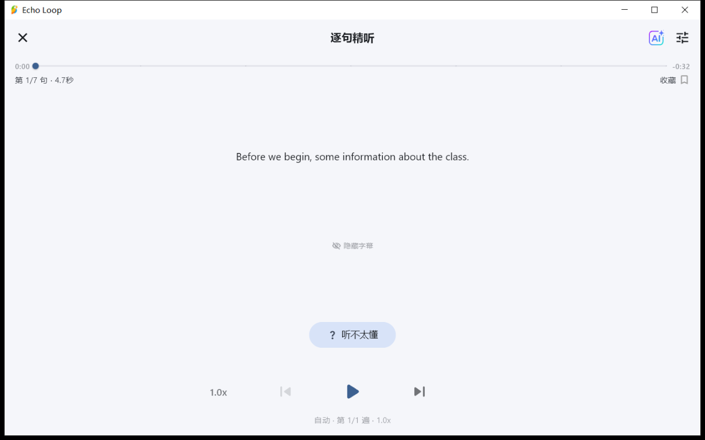
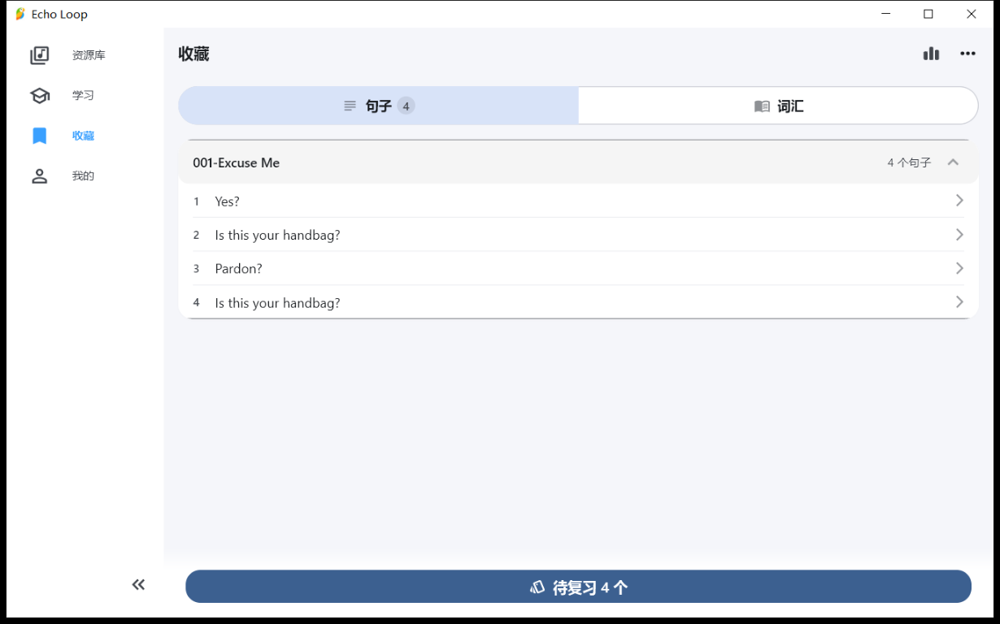
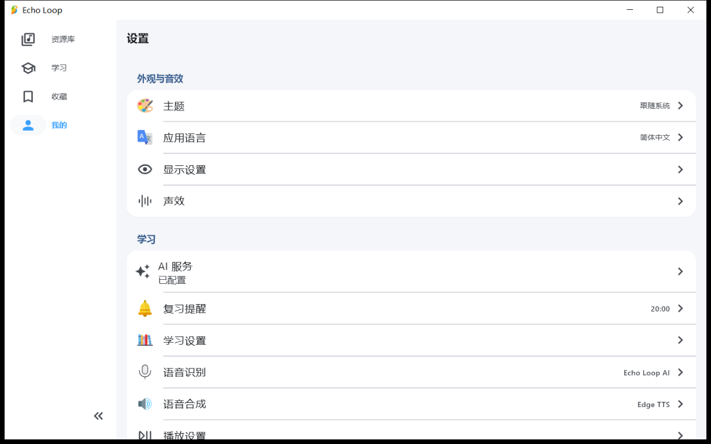

<div align="right">
  <strong>English</strong> | <a href="./README.md">简体中文</a>
</div>

<div align="center">
  

  <h1>Echo Loop for Windows</h1>

  <p><strong>Echo Loop on the Windows desktop: local-first, no sign-in, bring your own AI.</strong></p>

  <p>
    <a href="https://github.com/SeanStellar/echo-loop-windows/releases/latest"></a>
    
    <a href="./LICENSE"></a>
    
  </p>

  <p>
    <a href="https://github.com/SeanStellar/echo-loop-windows/releases/latest/download/EchoLoop-Windows-Setup-1.0.49-p3.5.exe"></a>
    <a href="https://github.com/SeanStellar/echo-loop-windows/releases/latest/download/EchoLoop-Windows-p3.5.zip"></a>
  </p>

  <p><sub>Version 1.0.49 (P3.5) · Unofficial fork · Not affiliated with the upstream authors or Minzu University of China</sub></p>
</div>

---

## Windows screenshots

These screenshots come from the Windows build in this repository, not from the official mobile store assets.

<table>
  <tr>
    <td align="center"><br/><sub>Library: community collections, local collections and import</sub></td>
    <td align="center"><br/><sub>Study: daily goal, weekly stats and recommendations</sub></td>
  </tr>
  <tr>
    <td align="center"><br/><sub>Collection: material progress, subtitles and status</sub></td>
    <td align="center"><br/><sub>First pass: intensive listening → shadowing → blind listening → retelling</sub></td>
  </tr>
  <tr>
    <td align="center"><br/><sub>Intensive listening: subtitles, speed, save and explanation</sub></td>
    <td align="center"><br/><sub>Favorites: sentences, vocabulary and due review</sub></td>
  </tr>
  <tr>
    <td align="center"><br/><sub>Settings: custom AI, speech recognition, TTS and desktop options</sub></td>
    <td align="center"><sub>Captured on Windows 10 x64 · 1230×768 window · Simplified Chinese</sub></td>
  </tr>
</table>

---

## What this build is

This is an **unofficial Windows desktop fork** of [Echo Loop](https://github.com/echo-loop/Echo-Loop). It is based on the official v1.0.49 release and keeps the Windows local-first changes.

It is not a thin mobile wrapper. The Windows build is intentionally local-first:

- **No account required**: sign-in, subscription and account-profile entries are hidden. Library, collections, podcast subscriptions, daily goals, check-in, favorites, dictionary, recording and local ASR all work directly.
- **Bring your own AI**: under Settings → AI Service, configure any OpenAI-compatible endpoint. Translation, sentence analysis, sense-group splitting, AI dictionary lookup and the AI assistant call your own service instead of Echo Loop cloud quota.
- **Full learning loop**: intensive listening, hard-sentence shadowing, blind listening, paragraph retelling, favorites review and spaced review are all included.
- **Desktop integration**: single instance, remembered window bounds, tray and close-to-tray, launch at startup, Windows Toast, System Media Transport Controls (SMTC) and update checks.
- **Local data**: the learning database, recordings, subtitles and dictionary stay on this machine. The API key is stored in local secure storage.

See [NOTICE](./NOTICE) for file-level modifications and [WINDOWS.md](./WINDOWS.md) for build and limitation details.

---

## Windows features

### Local-first

- Skips the first-run survey and goes straight to the app.
- Community collections and podcast subscriptions only need public data and the local database; no sign-in gate.
- Daily goals, automatic check-in, study calendar, favorites, offline dictionary and local ASR work offline.
- Sign-in, subscriptions, cloud quota and the account usage page are not integrated.

### Custom AI

- Any OpenAI-compatible service: Base URL, API key and model name.
- Covers translation, sentence analysis, sense-group splitting, AI dictionary lookup and the AI assistant.
- The API key is stored in `flutter_secure_storage`, not in project files.
- Retelling evaluation still depends on upstream cloud capability; custom-AI retelling scoring is not supported yet.

### Windows desktop experience

- Minimum window size 960×640; remembers position and size.
- A second launch activates the existing window instead of starting another database writer.
- Optional close-to-tray and launch at startup; quit from the tray menu.
- Windows “Now Playing” card with hardware media keys and play / pause / previous / next sentence.
- Review reminders and download completion use native Windows Toast.

### Recording, subtitles and media

- `record` + `record_windows` records 16 kHz / 16-bit WAV; `sherpa-onnx` transcribes locally.
- Download the ASR model once under My → Speech Recognition.
- Local audio / video import: mp3, m4a, wav, aac, flac, mp4, mov, m4v, mkv, plus OPUS / OGG / WEBM / AVI.
- Local transcription: ffmpeg decodes to 16 kHz WAV and sherpa-onnx produces subtitles in segments.
- Adaptive video split layout, video subtitle mask and media trimming from the official v1.0.49 release are included.

### Upstream sync

The official v1.0.49 release is synced, including:

- Library / collection search and collection learning progress.
- AI lookup from favorite vocabulary, manual dictionary lookup with history, and PDF export for favorite sentences / vocabulary.
- Retelling “show translation”, subtitle font size and weight, and subtitle translation.
- Adaptive video split across all study tasks, video subtitle mask and media trimming.
- Custom local collection covers, check-in celebration animation and sounds, and community download retry fixes.
- New in P3.4: subtitle editor and waveform interaction overhaul, media trim split width adjustment, preserving favorites and study progress after subtitle edits, and unified SVG icons.
- New in P3.5: loop gaps keep the playing state with a ring countdown on the main button, recording from the gap, video fullscreen controls auto-hide fix, and same-version backup restore fix.

---

## Download

| Option | File | Notes |
|---|---|---|
| Installer | [`EchoLoop-Windows-Setup-1.0.49-p3.5.exe`](https://github.com/SeanStellar/echo-loop-windows/releases/latest/download/EchoLoop-Windows-Setup-1.0.49-p3.5.exe) | Per-user install, no administrator rights |
| Portable | [`EchoLoop-Windows-p3.5.zip`](https://github.com/SeanStellar/echo-loop-windows/releases/latest/download/EchoLoop-Windows-p3.5.zip) | Unzip and run `echo_loop.exe`; keep the whole folder |
| Update manifest | [`version-windows.json`](https://github.com/SeanStellar/echo-loop-windows/releases/latest/download/version-windows.json) | Read by the in-app update checker |

- Requirements: Windows 10 / 11 x64.
- The portable build cannot be reduced to a single exe; keep `data/`, DLLs and license files together.
- The build is currently unsigned. SmartScreen may warn about an unknown publisher. A signing script exists but requires a trusted certificate.

SHA-256:

- Installer: `1DF14B3FFA630EFD92F0CA335E4736AAAEF01BC20C63A97776FA0F3478617DFD`
- Portable: `3E0F96C55AB2DABE92F2F5BCB8A6E84F870F61E39F2BE8B026A0F3F033B1A5BC`

---

## Quick start

1. Download the installer or portable build and launch it.
2. Import from Library → +: local files, direct links, Baidu Netdisk or podcasts.
3. Start the first pass: intensive listening → hard-sentence shadowing → blind listening → paragraph retelling.
4. For AI features: My → AI Service, enter Base URL, API key and model, then enable it.
5. For recording: My → Speech Recognition, download the local ASR model.
6. In My → Settings, configure close-to-tray, launch at startup, sound effects and subtitle size.

> Database upgrade: P3.4 moves the schema to 71 (from 69 for P3.3 users, or 66 for older installs). The first launch migrates automatically. Export a backup from Settings → Backup & Restore before upgrading if the data matters to you.

---

## How it differs from upstream

| Capability | Official Echo Loop | This Windows fork |
|---|---|---|
| Platform | iOS / Android / macOS | Windows 10 / 11 x64 |
| Account and subscription | Required | Not integrated |
| AI | Official cloud quota | Bring your own OpenAI-compatible service |
| Cloud transcription / retelling evaluation | Supported | Unavailable; local recording and local ASR instead |
| Learning loop | Complete | Complete (aligned with the official v1.0.49 release) |
| Desktop integration | — | Tray, autostart, SMTC, Toast, window memory, single instance |
| Account profile / usage page | Supported | Not merged |
| Updates | Official channel | This repository's `version-windows.json` |

This fork keeps the upstream AGPL-3.0 license and copyright notices. The upstream authors and Minzu University of China did not participate in the Windows port and do not provide support for it.

---

## Build from source

Requirements:

- Flutter 3.47.9 (Dart 3.13.7)
- Visual Studio 2022 Build Tools: Desktop development with C++, Windows SDK 10.0.26100, C++ ATL, C++ CMake tools
- `nuget.exe` on PATH
- Windows Developer Mode enabled
- An ASCII-only source path is recommended, for example `D:\EchoLoop`

PowerShell 5.1 (run line by line):

```powershell
git clone https://github.com/SeanStellar/echo-loop-windows.git
cd echo-loop-windows
flutter pub get
$env:ECHOLOOP_WINDOWS_BUNDLE_DIR = "$PWD\dist\EchoLoop-Windows"
flutter build windows --release
```

Build the installer (after installing Inno Setup 6):

```powershell
& "C:\Users\<you>\AppData\Local\Programs\Inno Setup 6\ISCC.exe" "installer\windows\EchoLoop.iss"
```

See [WINDOWS.md](./WINDOWS.md) for dependencies, signing, release and update-manifest details.

---

## Known limitations

- Unsigned build; SmartScreen may block it. A self-signed certificate does not remove the warning.
- Sign-in, subscriptions, cloud transcription, retelling evaluation and account quota are unavailable.
- Daily check-in sharing requires sign-in, so the share entry is hidden on Windows. Daily goals, automatic check-in and the study calendar work offline.
- Media trimming, local collection covers, adaptive video split, the subtitle mask, and the subtitle editor/waveform interaction come from the official v1.0.49 release. They pass the build and unit tests but still need validation with real videos, photo picking, long clips and long-audio editing.
- Native Toast display / click, community download UI end-to-end and minimized playback still need manual validation.
- Without MSIX packaging, Toast `cancel` may not work and repeated schedules may remain.
- SMTC exposes metadata and playback controls but no timeline scrubbing.
- Auto-update currently checks, prompts and opens the installer download; it does not silently install.
- System proxy and other platform integrations still need regression testing.

---

## Data and privacy

- The learning database lives under `%APPDATA%\top.valuespot\Echo Loop`.
- Recordings, subtitles, dictionary, favorites and progress stay on this machine by default.
- The custom-AI API key is stored in local secure storage; requests go directly to the service you configure.
- This fork does not collect account profiles and does not integrate official subscriptions or cloud quota.
- The installer removes the startup registry entry on uninstall. A portable build moved to another folder must re-enable autostart.

---

## Upstream and license

- Upstream: [echo-loop/Echo-Loop](https://github.com/echo-loop/Echo-Loop)
- This fork: [SeanStellar/echo-loop-windows](https://github.com/SeanStellar/echo-loop-windows)
- License: [AGPL-3.0](./LICENSE)
- Modification notes: [NOTICE](./NOTICE)
- Windows build and limitations: [WINDOWS.md](./WINDOWS.md)

This project follows the upstream AGPL-3.0 license. If you distribute modified versions or binaries, keep the license and copyright notices and provide the corresponding complete source.