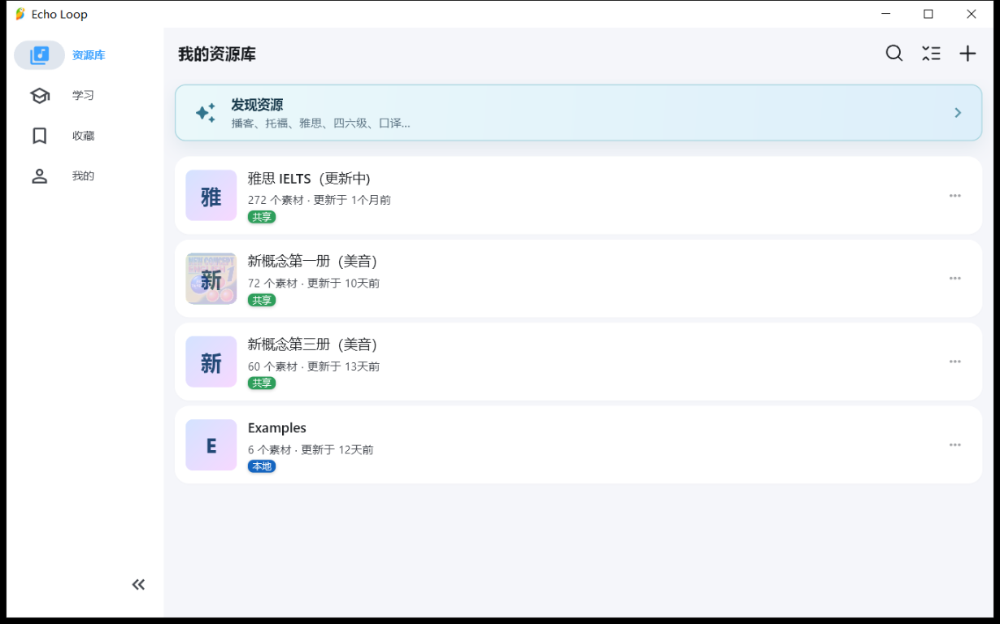
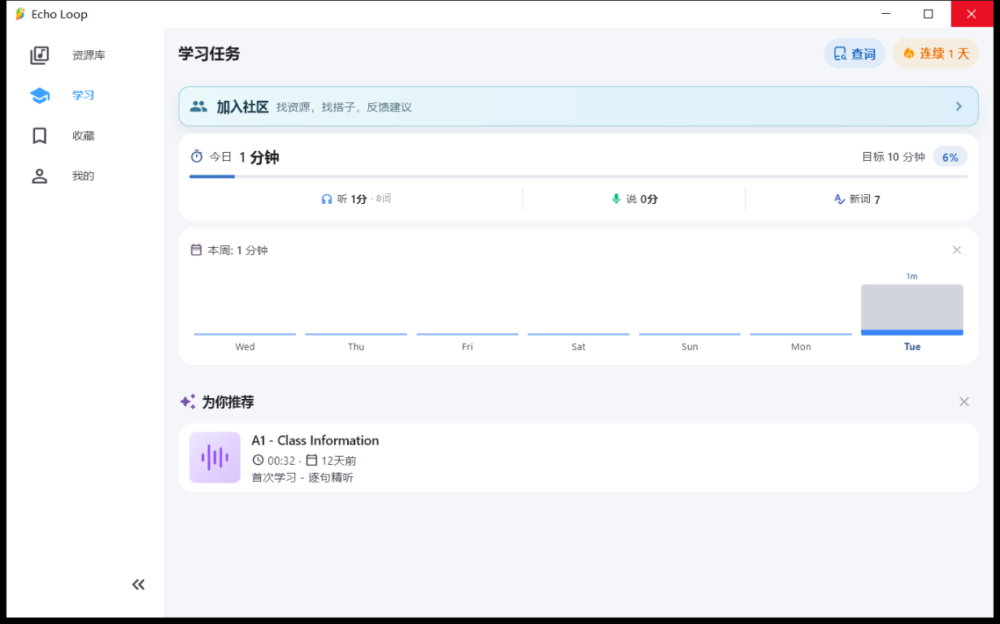
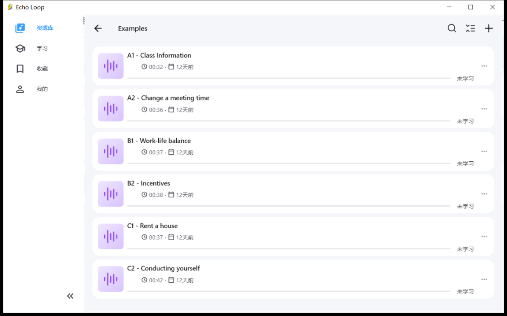
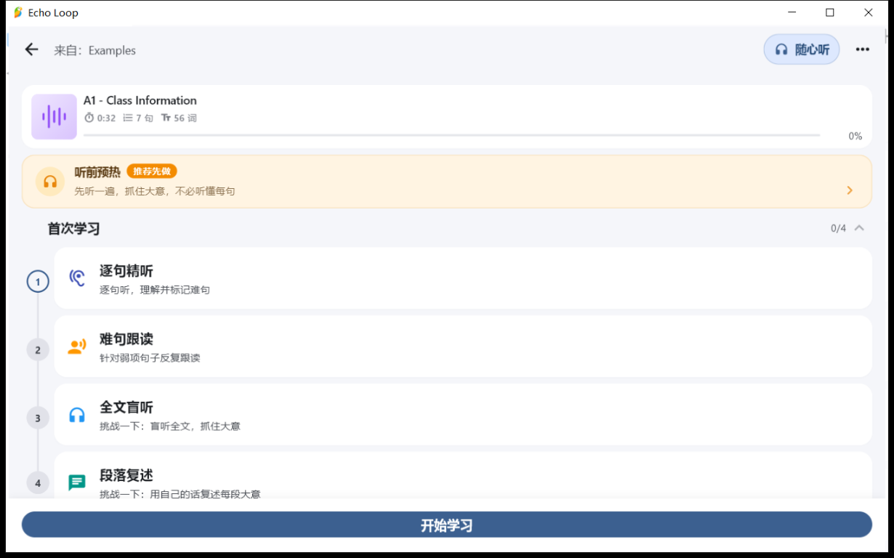
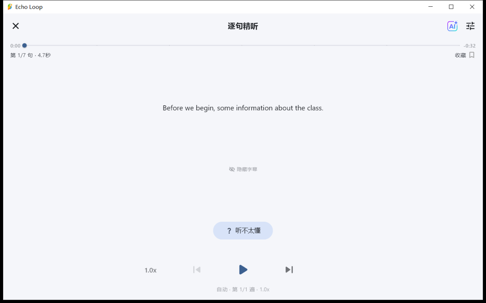
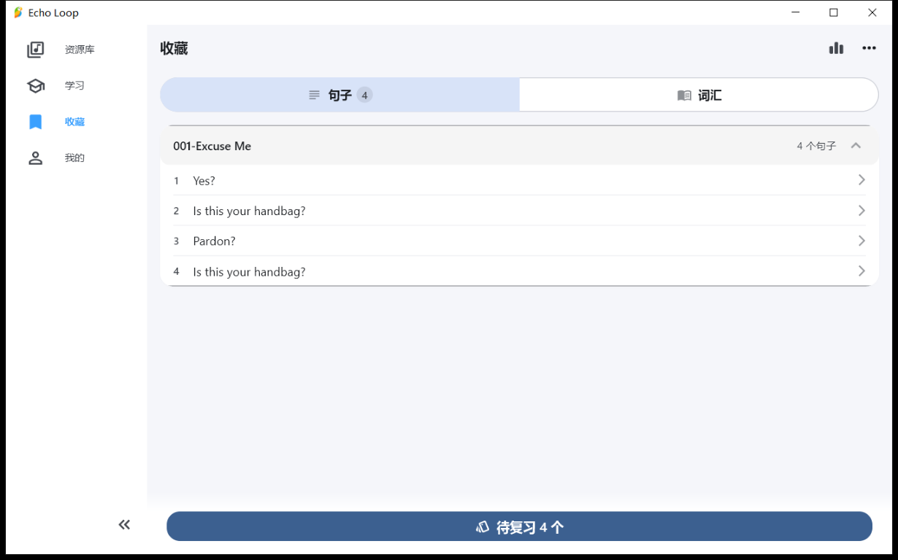
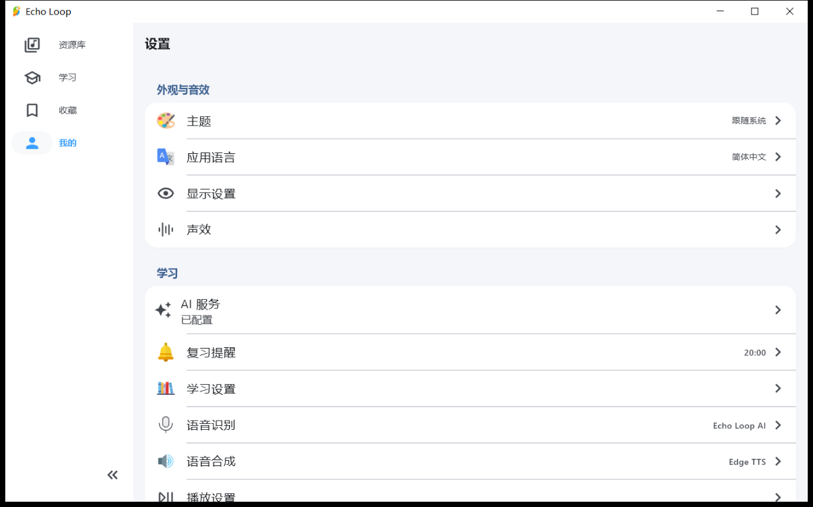

<div align="right">
  <a href="./README.en.md">English</a> | <strong>简体中文</strong>
</div>

<div align="center">
  

  <h1>Echo Loop for Windows</h1>

  <p><strong>把 Echo Loop 搬到 Windows 桌面：本地优先、无需登录、可直接接自己的 AI。</strong></p>

  <p>
    <a href="https://github.com/SeanStellar/echo-loop-windows/releases/latest"></a>
    
    <a href="./LICENSE"></a>
    
  </p>

  <p>
    <a href="https://github.com/SeanStellar/echo-loop-windows/releases/latest/download/EchoLoop-Windows-Setup-1.0.48-p3.3.exe"></a>
    <a href="https://github.com/SeanStellar/echo-loop-windows/releases/latest/download/EchoLoop-Windows-p3.3.zip"></a>
  </p>

  <p><sub>当前版本 1.0.48（P3.3） · 非官方修改版 · 与原作者及中央民族大学无隶属关系</sub></p>
</div>

---

## Windows 实机截图

以下截图来自本仓库构建的 Windows 版，不是官方移动端宣传图。

<table>
  <tr>
    <td align="center"><br/><sub>资源库：社区合集、本地合集与导入入口</sub></td>
    <td align="center"><br/><sub>学习页：今日目标、本周数据与推荐</sub></td>
  </tr>
  <tr>
    <td align="center"><br/><sub>合集详情：素材进度、字幕与学习状态</sub></td>
    <td align="center"><br/><sub>首次学习：精听 → 跟读 → 盲听 → 复述</sub></td>
  </tr>
  <tr>
    <td align="center"><br/><sub>逐句精听：字幕、变速、收藏与讲解入口</sub></td>
    <td align="center"><br/><sub>收藏：句子 / 词汇与待复习队列</sub></td>
  </tr>
  <tr>
    <td align="center"><br/><sub>设置：自定义 AI、语音识别、语音合成与桌面选项</sub></td>
    <td align="center"><sub>截图环境：Windows 10 x64 · 1230×768 窗口 · 简体中文</sub></td>
  </tr>
</table>

---

## 这个版本是什么

这是 [Echo Loop](https://github.com/echo-loop/Echo-Loop) 的**非官方 Windows 桌面分支**，基于上游 v1.0.47，并已同步官方主线 v1.0.48 在途 70 个提交中的非账号功能。

它不是把移动端简单套壳到桌面，而是针对 Windows 做了本地优先改造：

- **不需要账号**：隐藏登录、订阅与账号资料入口；资源库、合集、播客订阅、每日目标、打卡、收藏、词典、录音与本地 ASR 都可以直接使用。
- **AI 由你自己接**：设置 → AI 服务，可配置任意 OpenAI 兼容服务；翻译、句子解析、意群拆分、AI 查词与 AI 助手直接请求你配置的服务，不消耗 Echo Loop 云端额度。
- **学习闭环完整**：逐句精听、难句跟读、全文盲听、段落复述、收藏复习与间隔复习都在。
- **桌面能力补齐**：单实例、窗口位置记忆、托盘与关闭到托盘、开机自启、Windows Toast、系统媒体控制（SMTC）、自动更新检查。
- **数据留在本机**：学习数据库、录音、字幕与词典都在本地；API Key 只保存在本机安全存储。

详细的文件级修改说明见 [NOTICE](./NOTICE)，构建与完整限制见 [WINDOWS.md](./WINDOWS.md)。

---

## Windows 版特性

### 本地优先

- 跳过首次启动问卷，直接进入学习。
- 社区合集、播客订阅只依赖公开数据与本地库，加入时不再要求登录。
- 每日目标、自动打卡、学习日历、收藏、离线词典与本地 ASR 均可离线使用。
- 登录、订阅、云端额度与账号「用量与额度」页未接入。

### 自定义 AI

- 支持任意 OpenAI 兼容服务：Base URL、API Key、模型名。
- 覆盖翻译、句子解析、意群拆分、AI 查词与 AI 助手。
- API Key 存储于 `flutter_secure_storage`，不写入项目文件。
- 复述评估仍依赖官方云端能力，本分支暂不支持自定义 AI 复述评分。

### Windows 桌面体验

- 窗口最小 960×640，记住上次位置与大小。
- 重复启动只激活已有窗口，避免两个进程同时写数据库。
- 可开启关闭到托盘与开机自启；退出请使用托盘菜单。
- 接入 Windows「正在播放」卡片，支持硬件媒体键与播放 / 暂停 / 上一句 / 下一句。
- 复习提醒与下载完成使用 Windows 原生 Toast。

### 录音、字幕与媒体

- `record` + `record_windows` 录制 16kHz / 16bit WAV，`sherpa-onnx` 在本地转写。
- 首次使用需在「我的 → 语音识别」下载模型。
- 本地音频 / 视频导入，支持 mp3、m4a、wav、aac、flac、mp4、mov、m4v、mkv，以及 OPUS / OGG / WEBM / AVI。
- 本地转录：ffmpeg 解码为 16kHz WAV，sherpa-onnx 分段生成字幕。
- 视频自适应分栏、视频字幕遮罩与媒体剪辑已同步官方 v1.0.48 在途功能。

### 官方功能同步

已同步官方 v1.0.48 在途的非账号功能，包括：

- 资源库 / 合集搜索、合集学习进度。
- 收藏词汇 AI 查词、手动查词与历史、收藏句 / 词汇 PDF 导出。
- 段落复述「看译文」、字幕字号 / 粗细、字幕译文。
- 全部学习任务的视频自适应分栏、视频字幕遮罩、媒体剪辑。
- 本地合集自定义封面、打卡庆祝动画与音效、社区合集下载重试修复。

---

## 下载

| 方式 | 文件 | 说明 |
|---|---|---|
| 安装版 | [`EchoLoop-Windows-Setup-1.0.48-p3.3.exe`](https://github.com/SeanStellar/echo-loop-windows/releases/latest/download/EchoLoop-Windows-Setup-1.0.48-p3.3.exe) | 按当前用户安装，无需管理员权限 |
| 便携版 | [`EchoLoop-Windows-p3.3.zip`](https://github.com/SeanStellar/echo-loop-windows/releases/latest/download/EchoLoop-Windows-p3.3.zip) | 解压后运行 `echo_loop.exe`，整个文件夹需保持完整 |
| 更新清单 | [`version-windows.json`](https://github.com/SeanStellar/echo-loop-windows/releases/latest/download/version-windows.json) | 应用自动检查更新时读取 |

- 系统要求：Windows 10 / 11 x64。
- 便携版不能只复制 exe，必须保留 `data/`、DLL 与许可证文件。
- 当前未做代码签名，SmartScreen 可能提示「未知发布者」。签名脚本已就绪，但需要自备受信任证书。

SHA-256：

- 安装包：`1DF14B3FFA630EFD92F0CA335E4736AAAEF01BC20C63A97776FA0F3478617DFD`
- 便携包：`3E0F96C55AB2DABE92F2F5BCB8A6E84F870F61E39F2BE8B026A0F3F033B1A5BC`

---

## 快速开始

1. 下载安装版或便携版并启动。
2. 在「资源库 → +」导入本地文件、链接、百度网盘或播客。
3. 开始一段材料的首次学习：逐句精听 → 难句跟读 → 全文盲听 → 段落复述。
4. 如需 AI 能力：进入「我的 → AI 服务」，填写 Base URL、API Key 与模型名并启用。
5. 如需跟读 / 复述录音：在「我的 → 语音识别」下载本地 ASR 模型。
6. 在「我的 → 设置」中按需开启关闭到托盘、开机自启、声效与字幕字号。

> 数据库升级：v1.0.48 将 schema 从 66 升级到 69，首次启动会自动迁移；升级前建议在「设置 → 备份与恢复」导出一份备份。

---

## 与官方版的关系

| 能力 | 官方 Echo Loop | 本 Windows 分支 |
|---|---|---|
| 平台 | iOS / Android / macOS | Windows 10 / 11 x64 |
| 账号与订阅 | 需要 | 不接入 |
| AI 能力 | 官方云端额度 | 自定义 OpenAI 兼容服务 |
| 云端转录 / 复述评估 | 支持 | 不可用；提供本地录音与本地 ASR |
| 学习闭环 | 完整 | 完整（官方非账号功能已同步到 v1.0.48 在途） |
| 桌面能力 | — | 托盘、自启、SMTC、Toast、窗口记忆、单实例 |
| 账号资料 / 用量页 | 支持 | 未合并 |
| 更新渠道 | 官方 | 本仓库 `version-windows.json` |

本分支保留官方 AGPL-3.0 许可证与版权声明。上游作者与中央民族大学未参与本分支的 Windows 改造，也不对其提供支持。

---

## 从源码构建

前置条件：

- Flutter 3.47.9（Dart 3.13.7）
- Visual Studio 2022 Build Tools：Desktop development with C++、Windows SDK 10.0.26100、C++ ATL、C++ CMake tools
- `nuget.exe` 在 PATH 中
- Windows 开发者模式已开启
- 建议把源码放在纯英文路径下构建，例如 `D:\EchoLoop`

PowerShell 5.1（逐行执行）：

```powershell
git clone https://github.com/SeanStellar/echo-loop-windows.git
cd echo-loop-windows
flutter pub get
$env:ECHOLOOP_WINDOWS_BUNDLE_DIR = "$PWD\dist\EchoLoop-Windows"
flutter build windows --release
```

构建安装程序（安装 Inno Setup 6 后）：

```powershell
& "C:\Users\<你>\AppData\Local\Programs\Inno Setup 6\ISCC.exe" "installer\windows\EchoLoop.iss"
```

更完整的依赖、签名、发布与更新清单说明见 [WINDOWS.md](./WINDOWS.md)。

---

## 已知限制

- 未做代码签名，SmartScreen 可能拦截；自签名证书不能消除提示。
- 登录、订阅、云端转录、复述评估与账号额度不可用。
- 每日打卡分享依赖登录，因此 Windows 本地版会隐藏分享入口；每日目标、自动打卡与学习日历可离线使用。
- 媒体剪辑、本地合集封面、视频自适应分栏与字幕遮罩来自官方 v1.0.48 在途版本，已通过构建与单元测试，真实视频、相册选图与长素材剪辑仍需人工验收。
- Windows Toast 实际展示 / 点击、社区合集下载 UI 端到端、最小化续播仍需人工验收。
- 未以 MSIX 打包时，Toast `cancel` 可能不生效，重复调度可能残留。
- SMTC 支持元数据与播放控制，但不提供系统卡片进度条拖动。
- 自动更新目前是「检查 + 提示 + 打开安装包下载」，不会静默安装。
- 系统代理等平台能力仍需回归验证。

---

## 数据与隐私

- 学习数据库位于 `%APPDATA%\top.valuespot\Echo Loop`。
- 录音、字幕、词典、收藏与学习进度默认只保存在本机。
- 自定义 AI 的 API Key 保存在本机安全存储；请求直接发往你配置的服务。
- 本分支不收集账号资料，也不接入官方订阅与云端额度。
- 卸载安装版会清理开机自启注册表项；便携版移动目录后需要重新开启自启。

---

## 上游与许可

- 上游项目：[echo-loop/Echo-Loop](https://github.com/echo-loop/Echo-Loop)
- 本分支：[SeanStellar/echo-loop-windows](https://github.com/SeanStellar/echo-loop-windows)
- 许可证：[AGPL-3.0](./LICENSE)
- 修改说明：[NOTICE](./NOTICE)
- Windows 构建与限制：[WINDOWS.md](./WINDOWS.md)

本项目沿用上游 AGPL-3.0。分发修改版或二进制时，请保留许可证、版权声明，并提供对应的完整源码。